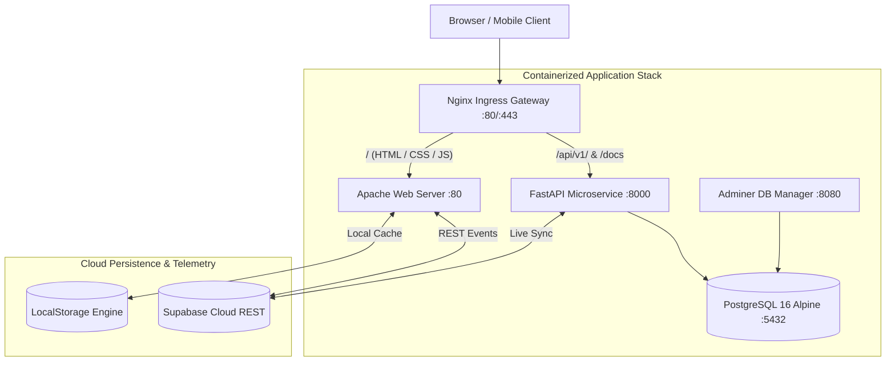

# 🏋️ Hanuman Gym — Enterprise Athletic Performance & Management Platform

[](https://www.python.org/)
[](https://fastapi.tiangolo.com/)
[](https://www.postgresql.org/)
[](https://www.docker.com/)
[](https://supabase.com)
[](https://github.com/)

> **Hanuman Gym** is a flagship full-stack athletic performance ecosystem. It features an 18-step AI Workout Blueprint Generator, an E-Commerce Pro Store, 12 Master Coach Bookings, 12 Interactive In-Kitchen Recipe Guides, 10 Maharashtra Branch Networks with live crowd meters, an Executive Athlete Command Center (**My Space**), and an Admin Command Center with a pre-seeded production telemetry dataset of **5,000 verified athletes**.

---

## 📑 Table of Contents
- [🌟 System Architecture & Topology](#-system-architecture--topology)
- [📦 Module Directory & Features](#-module-directory--features)
- [🐳 Production Docker Deployment](#-production-docker-deployment)
- [💻 Local Development Setup](#-local-development-setup)
- [📊 5,000+ Production Telemetry Dataset](#-5000-production-telemetry-dataset)
- [🧪 Automated Test Matrix & Sports Science Verification](#-automated-test-matrix--sports-science-verification)
- [🔐 Authentication & Default Credentials](#-authentication--default-credentials)
- [📡 FastAPI REST Endpoints Reference](#-fastapi-rest-endpoints-reference)

---

## 🌟 System Architecture & Topology

The platform operates on a resilient **Multi-Tier Hybrid Cloud Architecture** with automatic dual-engine storage fallbacks:



---

## 📦 Module Directory & Features

| Module | Core Purpose & Key Features | Primary Routes |
|---|---|---|
| **P Home & P About** | Brand flagship landing with unified 4-tier typography tokens (`Syne`, `Outfit`, `Inter`, `Plus Jakarta Sans`), hero video reel, value pillars, and trust metrics. | `P Home/index.html`<br>`P About/about.html` |
| **custom workout plan** | 18-step assessment wizard generating personalized AI mesocycles, periodization rules, Auto-1RM calculation (Epley formula), EMG muscle substitution, voice coach, and social card export. | `custom workout plan/workout-plan.html` |
| **P workout Program** | 7 pre-built flagship splits: 6-Day PPL, 6-Day Arnold Era, 4-Day Upper/Lower, 3-Day Full Body, Powerbuilding, and HIIT Shred. | `P workout Program/workout-programs.html` |
| **Form module** | Video technique academy covering 24 compound and isolation movements, muscle group filters, and bookmarks. | `Form module/index.html` |
| **Training_Section** | Roster of 12 Master Coaches with specialization tags, experience badges, and tiered booking drawers (Basic ₹2.4k, Standard ₹4k, Premium ₹6.5k). | `Training_Section/index.html`<br>`Training_Section/trainer-details.html` |
| **store** | Pro e-commerce store with apparel, competition belts, knee sleeves, supplements, interactive cart, coupon codes (`ELITE20`, `HANUMAN10`), and multi-payment checkout (UPI / Card). | `store/index.html`<br>`store/male-products.html`<br>`store/checkout.html` |
| **P Recipe** | 12 interactive recipe pages with dynamic serving macro recalculations (1x–4x), metric/imperial unit conversion, weekly grocery drawer, and in-kitchen step timers with audio chimes. | `P Recipe/recipes.html`<br>`P Recipe/recipe-view.html` |
| **Locations** | 10 Maharashtra branch centers with Haversine distance geolocation, live occupancy traffic meters, 3D amenities tours, and operating hours status. | `Locations/location.html` |
| **Memberships** | Tier pricing (Standard, Pro, Elite, Annual VIP), pass validity calculator, corporate inquiries, referral link generator, and Razorpay contracts. | `Memberships/index.html` |
| **login_register (My Space)** | Executive Athlete Portal with unified financial ledger, 5 Chart.js analytics graphs, Iron Streak tracker, PR celebrations, and PDF export. | `login_register/login.html`<br>`login_register/dashboard.html` |
| **admin** | Command Center rendering 5,000+ athletes, revenue doughnut distribution, activity volume streams, inventory repairs, and lead CRM. | `admin/index.html`<br>`admin/login.html` |

---

## 🐳 Production Docker Deployment

The platform provides a production-ready Docker Compose orchestration supporting Nginx, Apache Web, FastAPI, PostgreSQL, and Adminer.

### Quick Start with 1-Click Scripts
- **Windows**: Double-click [`scripts/docker-run.bat`](file:///c:/xampp/htdocs/PS-miniproject/scripts/docker-run.bat)
- **Linux / macOS**:
  ```bash
  chmod +x scripts/docker-run.sh
  ./scripts/docker-run.sh
  ```

### Manual Docker Compose Commands
```bash
# 1. Copy environment template
cp .env.docker.example .env

# 2. Build and launch all services in background
docker compose up --build -d

# 3. View running container health
docker compose ps

# 4. View live logs
docker compose logs -f
```

### Live Service Ports in Docker
- **Frontend & Web Modules**: [http://localhost/](http://localhost/)
- **Admin Command Center**: [http://localhost/admin/](http://localhost/admin/)
- **FastAPI Interactive Docs**: [http://localhost/docs](http://localhost/docs)
- **FastAPI Health Check**: [http://localhost/api/v1/health](http://localhost/api/v1/health)
- **Adminer Database Manager**: [http://localhost:8080/](http://localhost:8080/)
- **PostgreSQL Database Port**: `5432`

---

## 💻 Local Development Setup

### 1. Run the FastAPI Backend
```bash
cd backend
python -m venv venv

# Windows:
venv\Scripts\activate
# Linux/macOS:
source venv/bin/activate

pip install -r requirements.txt
uvicorn app.main:app --host 0.0.0.0 --port 8000 --reload
```

### 2. Serve the Frontend Web Application
Serve the root directory via Apache/XAMPP or Python static server:
```bash
# Via Python
python -m http.server 8080
```
Open [http://localhost/PS-miniproject/](http://localhost/PS-miniproject/) or [http://localhost:8080/](http://localhost:8080/).

---

## 📊 5,000+ Production Telemetry Dataset

The platform includes a deterministic production dataset generator ([`scripts/generate_5000_customers.js`](file:///c:/xampp/htdocs/PS-miniproject/scripts/generate_5000_customers.js)) that seeds the system with **5,000 verified athletes**:

* **5,000 Athlete Profiles**: Names, emails, Maharashtra branches, bodyweights, target goals, hydration, and daily calorie targets.
* **6,972 Financial Transactions**: Feeding net revenue KPIs and revenue distribution charts.
* **1,972 Store Orders**: Merchandising gear, apparel, and supplements.
* **2,492 Logged Workouts & Sets**: Bench, Squat, Deadlift, OHP, Pull-ups, and RDLs.
* **2,248 Workout Sessions**: Tonnage volume and duration telemetry.
* **409 Inquiries & Leads**: Free trial passes and corporate wellness proposals.
* **1-Click Seeder**: Click **`⚡ Seed 5,000+ Data`** in the Admin Command Center header to re-populate anytime.

---

## 🧪 Automated Test Matrix & Sports Science Verification

The platform maintains **10 comprehensive test suites** with **187 passing assertions (100% Pass Rate)**:

```bash
# Execute entire test matrix:
node "custom workout plan/tests/gym_domain_deep_audit.test.js"
node "custom workout plan/tests/qa_cloud_and_modules_audit.js"
```

| Test Suite | Assertions | Focus Area |
|---|---|---|
| `gym_domain_deep_audit.test.js` | 34 / 34 | BMR/TDEE math, 1RM Epley/Brzycki formulas, RP hypertrophy volume landmarks (MEV/MAV/MRV), Haversine distance, recipe scaler, store cart pricing. |
| `workout-logger.test.js` | 62 / 62 | Workout logging, tonnage calculation, RPE/RIR invariants, PR tracking. |
| `qa_cloud_and_modules_audit.js` | 18 / 18 | Supabase cloud REST adapter, offline dual-engine fallback, user identity hydration. |
| `muscle-anatomy.test.js` | 13 / 13 | Primary/secondary muscle activations across 24 movements. |
| `adaptive-training.test.js` | 12 / 12 | Deload week triggers and fatigue accumulation scoring. |
| `periodization-engine.test.js` | 11 / 11 | Undulating periodization and volume progression. |
| `emg-substitution.test.js` | 10 / 10 | Electromyography movement substitution matching equivalent joint angles. |
| `intensity-rules.test.js` | 10 / 10 | Intensity zone boundaries (60%–95% 1RM). |
| `canonical-profile.test.js` | 9 / 9 | Athlete canonical profile schema validation. |
| `auto-1rm-engine.test.js` | 8 / 8 | Theoretical and estimated 1RM derivation math. |

---

## 🔐 Authentication & Default Credentials

| Role | Email | Password | Access Area |
| :--- | :--- | :--- | :--- |
| **Administrator** | `admin@gym.com` | `password` | [Admin Command Center](http://localhost/PS-miniproject/admin/index.html) |
| **Athlete (Demo)** | `user@gym.com` | `password` | [My Space Dashboard](http://localhost/PS-miniproject/login_register/dashboard.html) |

---

## 📡 FastAPI REST Endpoints Reference

All API routes are prefixed under `/api/v1/`:

* **Authentication**: `POST /api/v1/auth/register`, `POST /api/v1/auth/login`, `POST /api/v1/auth/logout`, `GET /api/v1/auth/me`
* **Users & Profile**: `GET /api/v1/users/{id}`, `PUT /api/v1/users/{id}`
* **Workouts**: `GET /api/v1/workouts`, `POST /api/v1/workouts`, `DELETE /api/v1/workouts/{id}`
* **Purchases**: `GET /api/v1/purchases`, `POST /api/v1/purchases`, `DELETE /api/v1/purchases/{id}`
* **Inquiries**: `POST /api/v1/inquiries`, `GET /api/v1/inquiries`
* **Admin Management**: `GET /api/v1/admin/stats`, `GET /api/v1/admin/users`, `GET /api/v1/admin/purchases`, `GET /api/v1/admin/workouts`
* **Health Check**: `GET /api/v1/health`

---

## 📄 License
This project is open-source and available under the **MIT License**.
